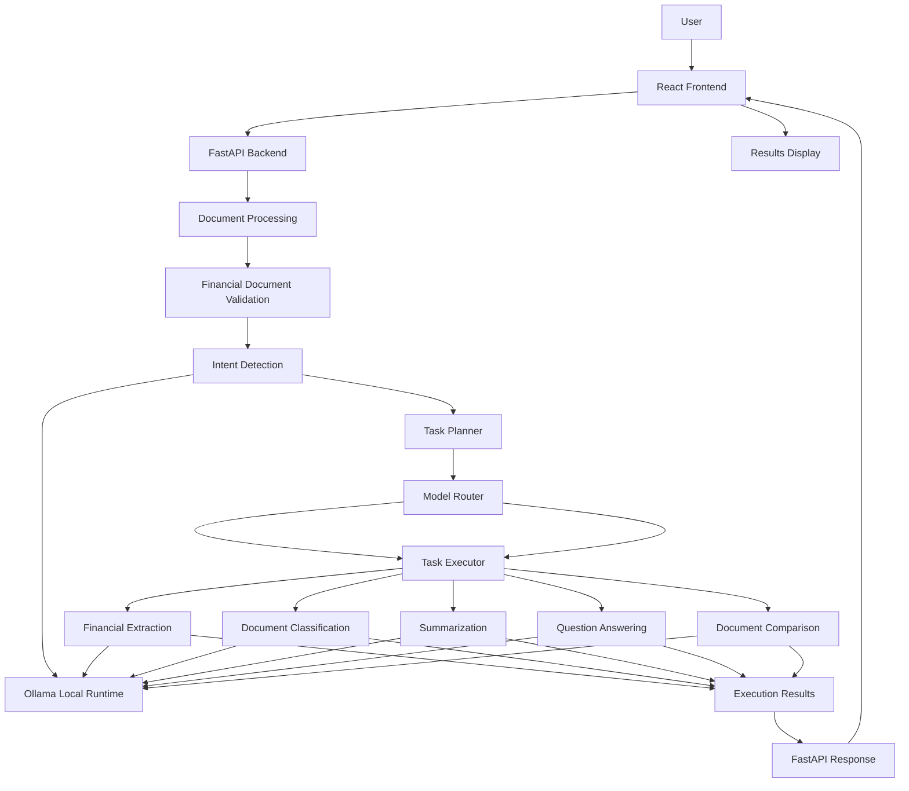

# FinFlow AI

## AI-Powered Financial Document Processing and Task Orchestration System

### 1. Project Overview

FinFlow AI is an AI-powered financial document processing system that understands user prompts, identifies the required tasks, creates an execution plan, and processes financial documents using specialized modules and locally running open-source language models.

The system supports multiple document uploads and multiple intents within a single request. It uses an orchestration layer to coordinate document processing, task planning, model selection, and execution.

FinFlow AI is built using FastAPI, React, and Ollama, with Qwen2.5 models for local AI processing.

### 2. Key Features

- Upload and process multiple financial documents.
- Support PDF, TXT, PNG, JPG, and JPEG formats.
- Detect single and multiple user intents.
- Generate task execution plans.
- Route tasks to suitable local language models.
- Execute tasks through specialized processing modules.
- Reuse extracted financial information in downstream tasks.
- Ask clarifying questions for ambiguous prompts.
- Provide clear responses for unsupported requests.
- Display detected intents, execution steps, selected models, and results.
- Validate uploaded documents and handle basic file-processing errors.

### 3. Processing Modules

FinFlow AI contains five main processing modules.

| Module | Description |
|---|---|
| Financial Information Extraction | Extracts structured financial information from uploaded documents. |
| Document Classification | Identifies the category of a financial document. |
| Document Summarization | Generates summaries using document content and structured financial information. |
| Question Answering | Answers user questions based on the uploaded financial documents. |
| Document Comparison | Compares financial information from multiple documents and identifies differences. |

### 4. Technology Stack

| Component | Technology |
|---|---|
| Frontend | React.js |
| Backend | Python, FastAPI |
| PDF Processing | PyMuPDF |
| Image OCR | Tesseract OCR, Pytesseract |
| Image Processing | Pillow |
| Local Model Runtime | Ollama |
| Language Models | Qwen2.5:3b and Qwen2.5:7b |
| Data Validation | Pydantic |
| Version Control | Git and GitHub |

### 5. System Architecture

The system follows a modular architecture with separate frontend, backend, orchestration, and processing components.

#### High-Level Architecture



#### Execution Workflow

1. The user enters a prompt and uploads one or more financial documents.
2. The backend validates the uploaded files and extracts their text.
3. The financial validation module checks whether the documents contain financial information.
4. The intent detector identifies the requested operation.
5. Ambiguous requests are returned for clarification, while unsupported requests receive an appropriate response.
6. The task planner creates an execution plan based on task priorities.
7. The model router selects a suitable local language model.
8. The task executor invokes the required processing modules.
9. Extracted financial information can be passed to downstream tasks.
10. The backend returns detected intents, execution steps, and processing results to the frontend.

### 6. Model Routing Strategy

FinFlow AI uses two locally running Qwen2.5 models through Ollama.

| Processing Task | Selected Model | Reason |
|---|---|---|
| Document Classification | Qwen2.5:3b | Relatively lightweight task |
| Document Summarization | Qwen2.5:3b | Relatively lightweight task |
| Financial Information Extraction | Qwen2.5:7b | More complex information extraction |
| Question Answering | Qwen2.5:7b | Requires document-based reasoning |
| Document Comparison | Qwen2.5:7b | Requires comparison of structured financial information |

The model router assigns models based on the processing task rather than using one model for every operation.

All language model processing is performed locally through Ollama. The application does not require a paid hosted LLM API.

### 7. Project Structure

```text
FinFlow-AI/
│
├── backend/
│   └── app/
│       ├── classification/
│       ├── comparison/
│       ├── document_processing/
│       ├── document_validation/
│       ├── orchestrator/
│       ├── question_answering/
│       ├── schemas/
│       ├── storage/
│       ├── summarization/
│       └── main.py
│
├── frontend/
│   ├── src/
│   ├── package.json
│   └── package-lock.json
│
├── sample_documents/
│   ├── valid/
│   ├── test_cases/
│   └── README.md
│
├── tests/
│
├
├── .env.example
├── .gitignore
├── LICENSE
├── requirements.txt
└── README.md
```

### 8. Installation and Execution

#### Prerequisites

Install the following software before running the application:

- Python 3.10 or later
- Node.js and npm
- Ollama
- Tesseract OCR

Note: Install the Tesseract OCR engine separately and ensure its executable is accessible through the system PATH. Installing `pytesseract` through pip alone does not install the Tesseract OCR engine.

#### Step 1: Clone the Repository

```bash
git clone https://github.com/Sucharitha-N-28/FinFlow-AI.git
cd FinFlow-AI
```

#### Step 2: Create a Python Virtual Environment

```bash
python -m venv venv
```

Activate the environment.

Windows PowerShell:

```powershell
.\venv\Scripts\Activate.ps1
```

#### Step 3: Install Backend Dependencies

```bash
pip install -r requirements.txt
```

#### Step 4: Configure Ollama

Install and start Ollama.

Download the required models:

```bash
ollama pull qwen2.5:3b
ollama pull qwen2.5:7b
```

Ensure Ollama is running before using the application.

#### Step 5: Configure Environment Variables

An `.env.example` file is provided as a reference for local application configuration. Configure environment variables according to the application's implementation.

#### Step 6: Start the Backend

From the project root:

```bash
uvicorn backend.app.main:app --reload
```

Backend API:

```text
http://localhost:8000
```

Interactive API documentation:

```text
http://localhost:8000/docs
```

#### Step 7: Start the Frontend

Open a separate terminal:

```bash
cd frontend
npm install
npm run dev
```

Open the local frontend URL displayed by Vite in the terminal.

### 9. Testing and Evaluation

Testing was performed using individual module test scripts and end-to-end orchestration test scripts.

The test scenarios cover:

- TXT, PDF, and image text extraction.
- Financial information extraction.
- Document classification.
- Document summarization.
- Question answering.
- Financial document comparison.
- Financial document validation.
- Intent detection.
- Model routing.
- Task planning.
- Task execution.
- End-to-end orchestration.
- Ambiguous and unsupported prompts.

#### Testing Summary

The manual testing process covered successful execution scenarios across the individual modules and orchestration workflow.

Key verified behaviors include:

- Correct classification of six company-provided sample documents.
- Extraction of several financial values from selected sample documents.
- Successful document summarization and question answering on selected test documents.
- Correct numerical differences in tested document comparisons.
- Correct model selection for the five processing tasks.
- Correct task ordering for multiple intents.
- Appropriate handling of ambiguous and unsupported requests.
- Successful execution of the four tested end-to-end orchestrator scenarios.

The test scripts are located in the `tests/` directory. They are manual Python test scripts and are not currently a formal pytest-based automated test suite.

Synthetic sample documents and test cases are provided in `sample_documents/`. Original company-provided documents are not included in the repository.

## Testing with Company-Provided Sample Documents

FinFlow AI was evaluated using all six sample documents provided as part of the company assignment.

- **Classification:** Successfully classified all six documents into their respective financial document categories.
- **Financial Extraction:** Worked successfully on Documents 1, 3 and 5. The remaining documents produced partial results.
- **Summarization:** Worked successfully on Documents 1 and 3. The remaining documents produced partial results.
- **Question Answering:** Worked successfully on Documents 1 and 3. The remaining documents produced partial results.
- **Document Comparison:** Produced strong results when comparing Documents 1 and 3. Comparisons involving other documents produced partial results.

Overall, Documents 1 and 3 demonstrated the strongest performance across all five processing modules. Performance on other documents varies depending on document structure, layout and the availability of extractable financial information.

The original company-provided documents were used for internal evaluation and are not included in the public repository.


### 10. Known Limitations

- Financial extraction accuracy can vary depending on document layout, quality, and formatting.
- Some financial fields may not be extracted even when information is present in the source.
- Summaries may occasionally contain qualitative statements that are not explicitly supported by the source document.
- Summary and comparison output formatting may require improvement.
- Some document-specific fields, such as company names in certain cash flow statements, may remain unavailable.
- Processing time depends on document size, model complexity, and local hardware.
- Large or complex documents may require additional processing time.
- OCR accuracy depends on image quality and document readability.

### 11. Security and Configuration

- Language models run locally through Ollama.
- Environment configuration is maintained separately from application source code.
- `.env` files, virtual environments, uploaded documents, and unnecessary generated files are excluded through `.gitignore`.
- Synthetic sample documents are provided for testing.
- Original company-provided financial documents are excluded from the public repository.

### 12. Future Improvements

- Improve financial extraction accuracy across different document formats.
- Reduce unsupported statements in generated summaries.
- Improve output formatting and consistency.
- Add more comprehensive automated tests.
- Improve processing performance for large documents.
- Enhance document-specific validation and error handling.

### 13. License

This project is licensed under the Apache License 2.0. See the `LICENSE` file for details.
